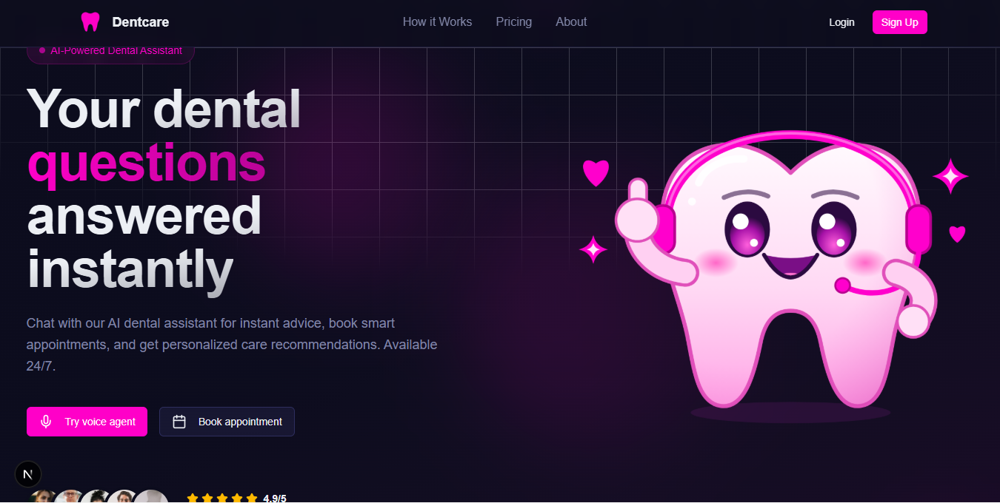

<h1 align="center">🦷 Dentcare – Dental Platform with AI Voice Agent 🦷</h1>




Project Goal

DentCare aims to make dental assistance more accessible by combining AI-powered conversations, voice interaction, and appointment management in one convenient platform.


✨ Highlights

🦷 AI-Powered Dental Assistant – Get instant dental guidance and answers to common oral health questions through an AI-powered assistant.

🎙️ Voice-Based Interaction – Interact with the dental assistant using voice conversations for a more natural experience.

📅 Appointment Booking – Schedule dental appointments through a simple and user-friendly interface.

🔐 Secure Authentication – User authentication and account management powered by Clerk.

👤 User Dashboard – Access and manage your personal account and appointment information.

📧 Email Notifications – Send appointment confirmation emails to keep users informed.

🗄️ Database Integration – Store and manage user and appointment information using Prisma ORM and PostgreSQL.

🎨 Modern UI/UX – Responsive interface with modern styling, smooth transitions, and interactive components.

⚡ Built with Next.js – Fast, scalable web application powered by Next.js and React.

---

## 🧪 .env Setup

```bash
NEXT_PUBLIC_CLERK_PUBLISHABLE_KEY=your_clerk_publishable_key
CLERK_SECRET_KEY=your_clerk_secret_key

DATABASE_URL=your_postgres_database_url

NEXT_PUBLIC_VAPI_ASSISTANT_ID=your_vapi_assistant_id
NEXT_PUBLIC_VAPI_API_KEY=your_vapi_api_key

ADMIN_EMAIL=your_admin_email

RESEND_API_KEY=your_resend_api_key

NEXT_PUBLIC_APP_URL=your_app_url

```

## Run the app

```bash
1- npm install
2- npm run dev
```
